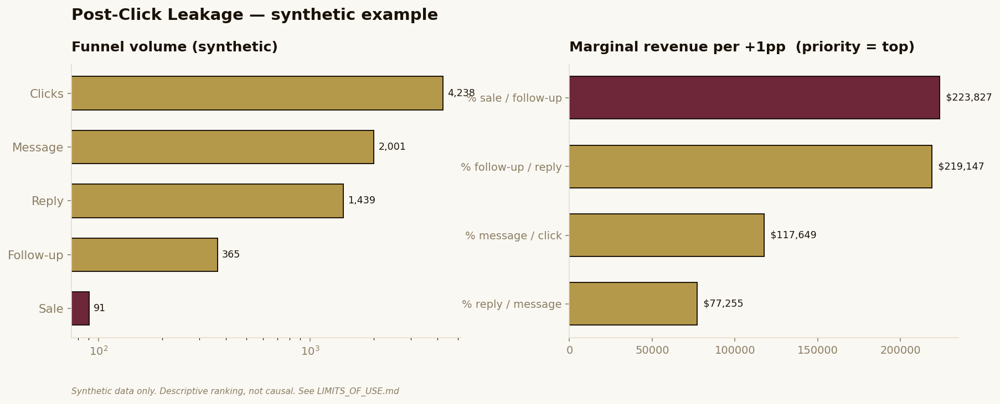

# Post-Click Leakage Calculator

**One question, answered fast and auditably:** with the leads you already paid for, which funnel stage is destroying the most money?

This is a small, transparent model that decomposes a WhatsApp acquisition funnel into its five real stages and ranks each stage by **marginal economic impact** — the revenue unlocked per point of improvement, given current volume — rather than by lowest conversion rate.

```
Clic  →  Mensaje  →  Respuesta  →  Seguimiento  →  Venta
```



---

## No causality without real data

This tool is **descriptive, not causal.** It identifies where money concentrates in a funnel. It does **not** prove that improving a given stage *causes* a specific revenue lift.

- The ranking answers: *"if this stage's rate rose by one point, how much revenue would that unlock, holding everything else constant?"*
- It does **not** answer: *"will my intervention actually raise that rate, and by how much?"* — that question can only be answered by a **real before/after measurement** on real traffic.
- Every `+10% / +20% / +30%` scenario in this repo is a **hypothesis to validate**, never a forecast or a guarantee.

The honest output to a client is always: *"with your current numbers, this stage has the highest economic leverage; we validate the hypothesis with a measured before/after."* If someone promises a guaranteed CAC reduction from a model like this, they are overselling. See [`LIMITS_OF_USE.md`](LIMITS_OF_USE.md).

---

## Why the ranking is non-obvious

The naive move is to attack the stage with the **worst rate**. That is usually wrong. A poor rate on a stage almost nobody reaches moves less money than a decent rate on a high-volume stage. The correct prioritization uses the economic derivative:

```
∂Revenue/∂p_i = Revenue / p_i
```

A +1 percentage-point improvement on stage *i* unlocks `Revenue / p_i × 0.01` in incremental revenue. Stages are ranked by that quantity, so the priority is the stage where a marginal improvement buys the most money — not the one that merely looks weakest.

---

## What's in here

```
post-click-leakage-calculator/
├── README.md
├── LIMITS_OF_USE.md            # the boundary of valid use
├── requirements.txt
├── src/
│   ├── leakage.py              # core model (pure, no I/O)
│   └── generate_synthetic.py   # synthetic dataset generator (fixed seed)
├── data/
│   └── synthetic_funnels.csv   # 12 fictional storefronts — SYNTHETIC ONLY
├── notebooks/
│   └── post_click_leakage.ipynb
└── assets/
    └── sensitivity_diagram.png
```

## Quickstart

```bash
pip install -r requirements.txt
python src/generate_synthetic.py          # regenerate the synthetic CSV
jupyter notebook notebooks/post_click_leakage.ipynb
```

Or use the model directly:

```python
from src.leakage import FunnelInputs, compute, scenario

inp = FunnelInputs(
    monthly_ad_spend=60000, cpc=8,
    rates={"message_per_click":0.40, "reply_per_message":0.70,
           "followup_per_reply":0.35, "sale_per_followup":0.25},
    avg_ticket=50000, gross_margin=0.45,
)
res = compute(inp)
print(res.priority_stage, res.roas)
```

## Data

All data is **synthetic**, generated with a fixed seed for reproducibility. There are **no real clients, no PII, no PHI, no secrets** anywhere in this repository — by design and by policy. See [`LIMITS_OF_USE.md`](LIMITS_OF_USE.md).

## License

MIT. See [`LICENSE`](LICENSE).
